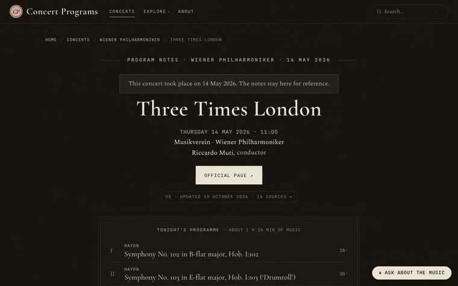
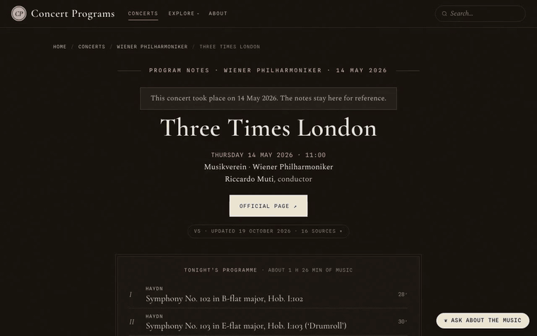
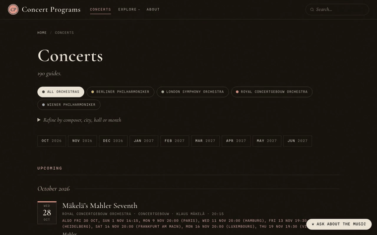
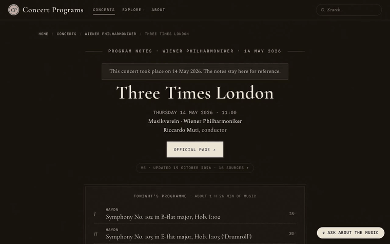
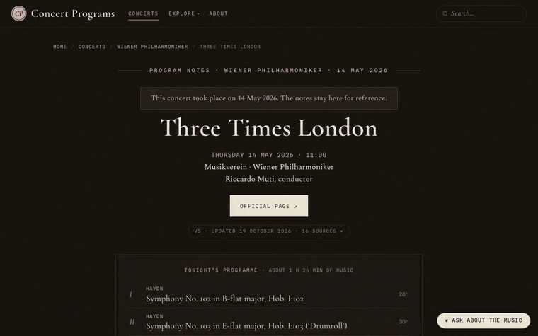

concertprograms.eu is a free site with listening guides for classical concerts. It covers four orchestras: the Berliner Philharmoniker, the Wiener Philharmoniker, the Royal Concertgebouw Orchestra and the London Symphony Orchestra. I maintain it in my spare time, and from today it is open to everyone.

## Why prepare for a concert

A classical concert is an event that is a pleasure to prepare for, and the preparation changes the evening itself: the better prepared you arrive, the deeper and more fulfilling the experience becomes. Knowing the works, the composers and the context before the first note means you can follow the music in the hall instead of meeting it for the first time.

The guides are there to make that preparation easy to find, in one place, before every concert.

## Where the guides come from

I have made concert programmes like these for myself and for friends since 2022. Over that time I refined the prompts and the format, concert after concert, until the guides covered what I wanted to know before going to the hall.

concertprograms.eu puts that same format on a site, for every concert of the four orchestras, so anyone can use it. The orchestras publish their own notes; the site puts all four in one format, one calendar and one PDF per concert.

The guides are generated with AI from those prompts. Reader corrections go into new versions of each guide (more on that below).

## What a guide contains

The site has about 190 guides at launch. Each one has:

- the programme in running order
- notes on each work
- the performers
- three book recommendations
- a PDF to download and take to the hall

The calendar shows the coming months at a glance. You can search by composer, performer or venue.

For questions about the music on a programme there is a small chat assistant, available at any time. It runs on Claude Haiku.

## Books for each concert

Every guide has a short "Further reading" list of three books about the music or the composers on the programme. Two are marked "Accessible" and one "Deeper", so you can choose between a quick introduction and a more detailed study.

Each entry gives the author, publisher and year, and one or two sentences on why the book fits this concert. For the Wiener Philharmoniker's "Three Times London" concert (Haydn's Symphonies Nos. 102, 103 and 104), for example, one pick is David Wyn Jones's The Life of Haydn (Cambridge University Press, 2013), recommended for its account of the two London visits that produced his last twelve symphonies.

The titles link to Google Books by ISBN. They are plain links, not affiliate links.

## Corrections from readers

Programmes change: a soloist is replaced, a work is swapped, a date moves. At the end of every guide there is an "Email a correction" button. It opens an email with the concert's name already filled in.

Every correction becomes a new version of the guide, recorded in the guide's change log. For suggestions, such as an orchestra or a hall to add, or a book or a recording worth recommending, there is the [Corrections & suggestions](https://concertprograms.eu/feedback) page. I read every message and aim to reply within a few days.

## Next: listening playlists

The next feature is a pre-listening playlist for each concert, on Spotify and Apple Music. The guide pages already have a place for the links. No guide has a playlist yet.

The plan for choosing recordings: the performing orchestra's own recording of a work when one exists, otherwise a well-known reference recording. I check every playlist before it goes on the site.

## Try it

If you have a concert coming up with one of these orchestras, or you are simply curious, the guides are at [concertprograms.eu](https://concertprograms.eu).

See also the [Concert Programs portfolio page](/portfolio/concert-programs/).
