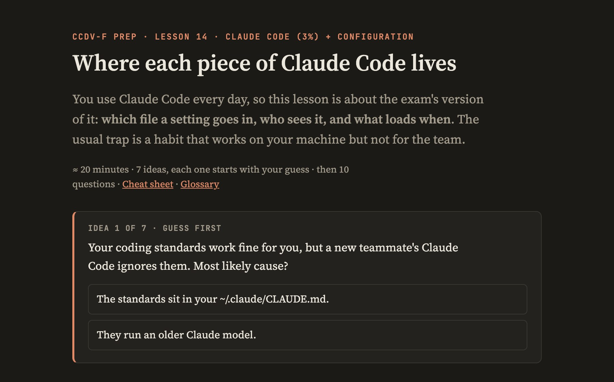
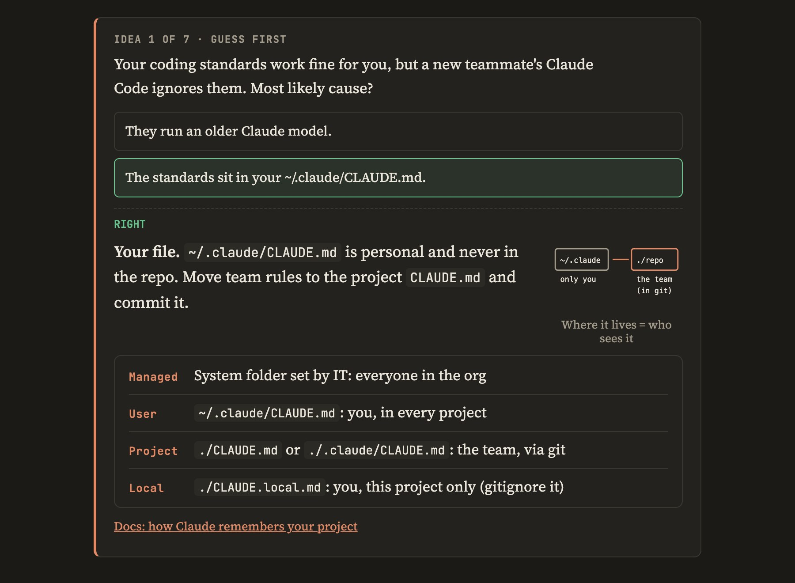

On 3 November 2026 I passed the Claude Certified Developer – Foundations (CCDV-F) exam ([badge on Credly](https://www.credly.com/badges/909e8d52-3d9e-4207-a7bc-e47cbd4f12b1)). I prepared from 29 October to 2 November with Matt Pocock's [`teach` skill](https://github.com/mattpocock/skills) for Claude Code, which writes one short interactive lesson at a time and tracks what you got wrong. The plan was 2–3 hours a day. I didn't track the actual hours.

The takeaway: <u>**the method worked**</u>. It works like a private tutor that knows all your weak spots, learns your rhythm and improves with you: it kept a record of every miss, moved fact-heavy lessons to the morning when I was tired in the evening, and changed the lesson format each time I said one wasn't working. Guess-first lessons, plus re-testing every miss on later days, are what moved my scores. My result was about 87%. My own estimate is that reviewing the last lessons a couple more times would have put me close to 98%: the areas I scored lowest on were the ones taught once and never re-tested (details below).

I didn't start from zero. I use Claude Code every day, and I had finished Module 1 of Anthropic's official Skilljar course. Claude Code itself is about 3% of the exam. Most of it is the Claude API, model selection, agents, prompting, tools and MCP, and security.

## How the workspace is set up

The skill treats a folder as a teaching workspace:

- `MISSION.md`: why you are learning. The skill refuses to write it for you.
- `lessons/`: one HTML file per lesson, each with a quiz.
- `reference/`: printable cheat sheets and a glossary.
- `learning-records/`: one file per lesson with the score, each miss, and what to re-test.
- `NOTES.md`: a running summary and your preferences, so the next session doesn't re-read everything.

It has five fixed rules. You must commit a guess before any answer is shown. You write the mission yourself. The grading rubric is written into the lesson before the quiz, and every answer is graded by quoting a rubric line. You name one person who hears your progress, plus a date (for me, a friend, every evening, with that day's percentage). The agent reads only the last three records plus the summary.

Every fact in a lesson was checked against the live docs before the lesson was written (Anthropic's, plus MDN, Google's code review guide and Martin Fowler for the general engineering lesson), and each lesson links its sources.

## The scores

- Lesson 1, a weighted diagnostic: 69%.
- Lessons 2–4, read first, quiz after: 75%, 75%, 40% (the last one done tired, late in the evening).
- Lesson 5, the first in the guess-first format: 92%.
- Lessons 6–17: between 80% and 100%.
- A paid Udemy CCDV-F practice exam on 2 November: 84% (45/53).
- A mock built from my misses, same evening: 82% (18/22).
- The exam: passed, with about 87%.

## Three formats rejected in one evening

On 29 October I rejected three ways of presenting the material: comparison tables, pseudo-code request/response traces, and numbered lists. My words at the time: "I don't think I'm retaining information with tables", then "numbered lists in the lesson are not good enough for retention".

What had worked that day was a question in chat that I had to answer before getting the explanation. From 30 October every lesson opened each idea with a question on the page. The explanation unlocked only after I answered. The first lesson in that format scored 92%, against 69–75% for the earlier full-length lessons.

Lesson 14, before answering. The explanation stays hidden until I pick an option.

The same question after answering: a one-line explanation, a small drawing, the details as label/fact rows, and a link to the docs page it came from.

Later I asked for two more changes: a small SVG drawing for each idea, and short label/fact rows instead of dense paragraphs. Tables stayed out of lessons but came back for one thing: a status-code sheet to memorise. But that's just me: I like memorising numbers (I once [memorised the first 2,000 digits of π](https://jacopocastellano.com/blog/7-benefits-of-memorizing-the-first-2000-digits-of-/)) 😄

## What spaced re-testing did

Each miss came back in later quizzes, reworded so I couldn't answer from memory of the earlier question.

The clearest case is the mixed tool turn: a response containing both a server tool call (which Anthropic runs) and a client tool call (which you run). The correct reply returns a `tool_result` only for your own tool. I got it wrong in lessons 3 and 6, right in lesson 11, and wrong again on the 2 November mock. On the exam, Claude API Mechanics and Tool Implementation, the objectives I'd expect it under, both scored 100%. The report doesn't say which questions were in which objective.

The tired evening lesson scored 40%: right on the judgement questions, wrong on all three detail facts. The next morning, recalled cold in chat, the same facts scored 2.5/3.

## The docs had moved past the exam guide

Checking the lessons against the live docs between 29 October and 2 November found changes that older study material and practice banks don't reflect:

- Every model ID is now a pinned snapshot, including dateless ones like `claude-opus-5-5`. Only models before 4.6 have aliases that move.
- Forcing a tool call (`tool_choice` of type `any` or `tool`) returns a 400 on Opus 5.5, Sonnet 5.5 and Fable 5.1.
- API version 2026-10-21 rejects `temperature`, `top_p` and `top_k`.
- Prefilling Claude's reply returns a 400 on 4.6+ models.
- On Claude 4.7+ models, manual extended thinking (`enabled`) returns a 400; adaptive thinking replaces it.

The exam guide predates most of these. The lessons taught both versions, with one rule: answer in the frame the question sets.

The exam didn't ask about these recent changes. I'm happy to have learned them anyway, since they are how the API behaves now.

## Where daily Claude Code use helped and where it hurt

I work with Claude Code every day, and that helped. It wasn't enough on its own. Many notions had to be studied from the docs, and many questions are built around traps: wrong answers that sound right if you only know the tool from daily use.

Daily use helped most on agent patterns and on tools and MCP, where I guessed most answers right before the explanation. It hurt on raw API questions. Local stdio MCP servers and the Agent SDK are what Claude Code teaches you to expect, and I picked them where the answer was the hosted MCP connector or Managed Agents.

Another pattern showed up twice: picking the safer-sounding option over the documented default. A subagent with no `tools` field inherits all tools; it is not read-only. An API key's expiration is set at creation and can't be added later.

## What the score report shows

The report gives the percentage of correct items for 25 objectives.

- 100% on 17, including Claude API Mechanics, Tool Implementation, MCP Dev, Model Selection, Cost/Token Management, Prompt Engineering, Context Engineering, AI App Security, Hooks and Identity/Secrets. Each of these had its own lesson and was re-tested on later days.
- 67%: Software Engineering Foundations, Claude Code Operation.
- 50%: Agent Architecture, Agent Construction, LLM Fundamentals, Tech Fundamentals, Agentic Customization. Agents were also my weakest domain on the Udemy mock (63%).
- 0%: Understanding Requirements. It was covered inside one lesson on general software engineering and never re-tested.

## Limits

This is one person and one exam. The method needs a Claude Code plan. The lesson scores come from quizzes the same agent wrote, so they measure progress, not exam readiness. The report gives percentages per objective but not how many items each had, and some objectives probably had only one or two. The link between spaced re-testing and the 100% objectives is what I saw, not a controlled comparison.

## What's next

I'm now testing the same method on completely different topics, such as the lives and pieces of composers and German grammar. Let me know if you're interested in how those turn out.

## Sources and courses

Official Anthropic material:

- [Claude Certified Developer – Foundations learning path](https://anthropic-partners.skilljar.com/path/claude-certified-developer-foundations) on Skilljar: the five-module prep course.
- [The official exam guide (PDF)](https://everpath-course-content.s3-accelerate.amazonaws.com/instructor/6nizmqk8tpzpfjvt6qmmav7rh/public/1783542875/Claude+Certified+Developer+%E2%80%93+Foundations+Exam+Guide.pdf): blueprint, domain weights, format.
- [Claude Platform docs](https://platform.claude.com/docs): the source for every API fact in the lessons, including [model deprecations and pinning](https://platform.claude.com/docs/en/about-claude/model-deprecations).
- [Claude Code docs on hooks](https://code.claude.com/docs/en/hooks) and the [Agent SDK overview](https://code.claude.com/docs/en/agent-sdk/overview).
- [Effective context engineering for AI agents](https://www.anthropic.com/engineering/effective-context-engineering-for-ai-agents), from Anthropic's engineering blog.

For the general software engineering part of the exam:

- [MDN on HTTP status codes](https://developer.mozilla.org/en-US/docs/Web/HTTP/Status)
- [Google's engineering practices (code review)](https://google.github.io/eng-practices/)
- [Martin Fowler on refactoring](https://refactoring.com/)
- [ISO/IEC 25010 quality model](https://iso25000.com/index.php/en/iso-25000-standards/iso-25010)

Other:

- Matt Pocock's [`teach` skill](https://github.com/mattpocock/skills) for Claude Code.
- A paid Udemy CCDV-F practice exam (53 questions).
- A [firsthand CCDV-F report on testengineeringnotes.com](https://testengineeringnotes.com/posts/2026-09-16-claude-certs/).
